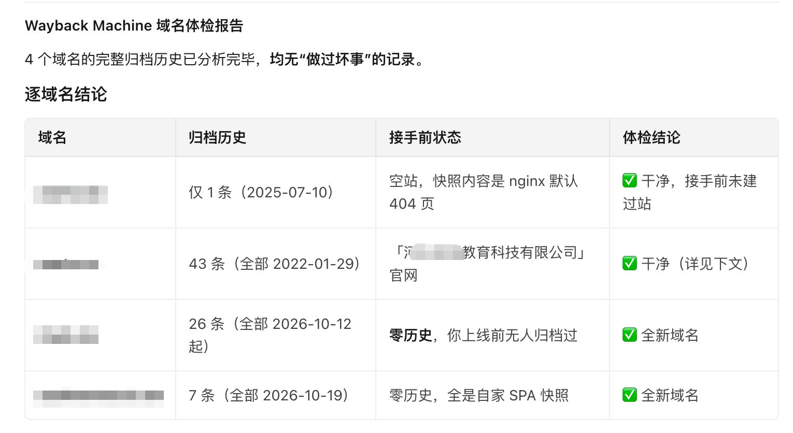

# 你买的域名有黑历史吗？说说域名选择的一些门道

前一段时间在指导我大学同学的学生们做网站。某天晚上，他们突然发消息问我：域名的 DNS 被污染了怎么办？

我的第一反应是不可能。做站这么多年，DNS 污染这事我只在文章里见过，从没落到自己头上。

不过话说出口就得负责。我把他们的项目代码和服务器权限都要了过来，折腾了一番，最后得出一个不想接受的结论：**这个域名确实被 DNS 污染了**。国内用户访问这个地址，会被强制解析到一个毫不相干的 IP。

排查下来，问题不在代码、不在服务器，在他们买的这个域名上——它有「前科」。

最后我把项目换成了我名下的一个二级域名，问题迎刃而解。他们买的那个域名算是废了，只能重新买一个，前面的钱打了水漂。

## 域名为什么会「带病」

大部分人买域名，默认它是全新的。但市场上流通的域名，很多是被前任主人弃用的「二手域名」。

前主人拿它做过什么，域名是会记着的：做过博彩、色情、私服、诈骗、垃圾站群，搜索引擎会有记录，安全厂商会拉黑名单，某些地区的运营商甚至直接在 DNS 层面把它污染掉——就像我同学学生遇到的那个，域名一到手就是「带病上岗」，怎么折腾服务器都没用。

更坑的是，这些历史在注册商页面上完全看不到。你查询的时候，它显示「可注册」，干干净净。

## 买之前，先给它做个体检

后来我专门研究了下这类问题，发现有个网站可以查域名的「前世」：**Wayback Machine**（https://web.archive.org/）。

它是互联网档案馆，从 1996 年起一直在给全网网页拍快照。把域名输进去，就能看到它这些年被拍下的所有历史页面——以前是什么站、什么内容、什么时候断更的，一目了然。



不过说实话，当时我打开这个页面查域名，压根看不懂那些时间轴和快照怎么用。看不懂就交给 AI 了——我把自己的几个域名发给 AI，让它去 Wayback Machine 逐个查，马上得到一份「域名体检报告」：每个域名归档了多少条、以前是什么站、有没有黑历史，表格清清楚楚。

**这段话你可以直接复制给 AI（把域名换成你自己的）：**

```
请你当一名「域名体检师」。我会给你几个域名，请你逐个到
Wayback Machine（https://web.archive.org/）查询它们的历史：

1. 打开 https://web.archive.org/web/*/域名 ，记录快照总数、
   最早和最晚的归档时间；
2. 抽查最早、中间、最近的几个快照，判断这个域名以前是做什么的；
3. 重点排查有没有博彩、色情、私服、诈骗、垃圾站群这类黑历史；
4. 把结果整理成一份「域名体检报告」表格，包含：域名、归档条数、
   时间跨度、接手前状态、有无黑历史、体检结论。
   查不到记录的，如实标注「零历史」。

我给你的域名是：example.com、example.net
```

查完你会很直观地看到三种结论：**干净**（有历史但都是正经站）、**全新**（零归档记录，没人用过）、**有问题**（历史上做过灰产，直接放弃）。有问题的一票否决，别心疼钱——域名费是小头，污染、被墙、不收录才是大头。

## 说说域名选择的几个门道

**门道一：后缀尽量主流，便宜后缀少碰**

.com / .net / .org / .io 这些主流后缀优先。像 .cc / .xyz 这种主打「便宜」的后缀，尽量不碰——黑灰产最爱用它们批量注册，整批后缀的名声都被拖垮了：容易被墙、容易被污染、做邮箱发出去的信也容易进垃圾箱。省下的几块钱，后面要用十倍的麻烦还。

**门道二：二手域名必须查历史**

不管是买的、抢的还是朋友转让的，只要不是你亲手从零注册的，都先去 Wayback Machine 查一遍（就用上面的提示词）。几分钟的事，能帮你避开我同学学生踩的那个坑。

**门道三：查完历史，再查一遍「拦截记录」**

历史干净还不够，有些域名是被微信或浏览器拦截过的。注册前可以再用微信的拦截检测、Google 安全浏览透明度报告（https://transparencyreport.google.com/safe-browsing/search）查一下，确认没有「被拦截」的前科。

**门道四：别只看首年价**

很多域名首年 1 块钱、6 块钱，续费直接翻十倍。下单前把续费价看清楚，算的是三五年的总账，不是第一年的账。

## 推荐几个域名查询和购买的工具

下面这 5 个都在我仓库的「网站建设」分类里，从起名海选到下单购买，正好一条链。

**01 · Query.Domains**　`https://query.domains/zh-hans`

批量域名可用性检查工具。输入一个关键词，最多可以同时查 20 个后缀，支持 1000+ 种 TLD，基于实时 DNS 和 WHOIS 查询，结果即时流式返回。免费使用，还提供开发者 API。适合起名阶段批量海选，一轮筛掉大部分不可用的。

**02 · NamingCube**　`https://www.namingcube.com/zh/check`

免费查域名是否可注册，主打「证据优先」：结果里带注册局/RDAP 数据来源和查询时刻，而不是只给你一个「可用」的结论。确认可注册后，再看它附带的 Spaceship、Namecheap、Porkbun、Cloudflare、GoDaddy 公开参考价和首年优惠码，还会提醒你对比续费价，避免只看首年便宜选错。

**03 · Instant Domain Search**　`https://instantdomainsearch.com/`

号称「最快的域名搜索工具」：边打字边出结果，800+ 后缀实时刷新可用性，还自带 AI 域名生成器，想不出名字时可以让它帮你造。它本身是 ICANN 认证注册商，查到可用的可以直接下单。适合想到什么马上验证。

**04 · Namecheap**　`https://www.namecheap.com/`

老牌注册商，以便宜著称，.com 首年 6.48 美元上下，免费送 WHOIS 隐私保护，主机、企业邮箱也一站式配齐。促销很勤快，但下单前记得核对续费价。

**05 · Spaceship**　`https://www.spaceship.com/`

Namecheap 团队推出的新品牌，主打「按成本价卖域名」：注册和续费都不加价，DNS 想换哪家换哪家，不强制用它自家解析。界面清爽现代，管理功能齐全，.com 目前 8.88 美元。想要省心长持的话，这个思路比较合适。

## 最后

域名是网站的「门牌号」，也是唯一跟着你一辈子的资产——代码可以重写，服务器可以换，域名换了，前面攒的收录、外链、用户认知全部清零。

花几分钟查一查历史，比事后折腾 DNS 和收录省一百倍的事。

祝大家的域名都清清白白。

---

数据截至 2026-11-11：本文收录「网站建设」分类下 5 个域名查询/购买工具，均逐一打开核实过。

仓库地址（公众号「阅读原文」）：https://linkpad.site/repo/4d19583b-37bb-4232-af2f-edd90c855f98

#域名 #网站建设 #独立开发 #出海 #建站避坑
