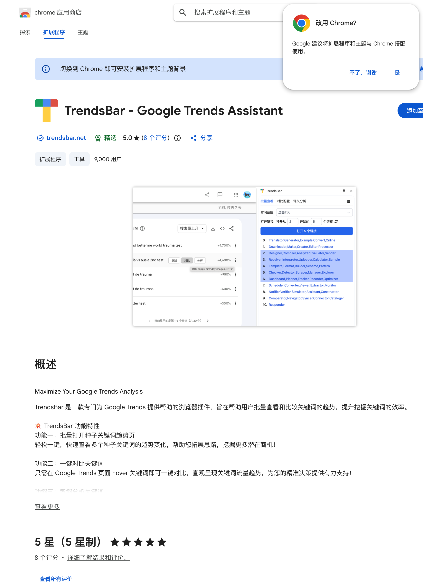
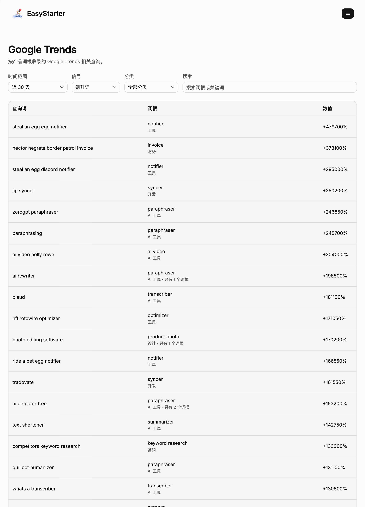
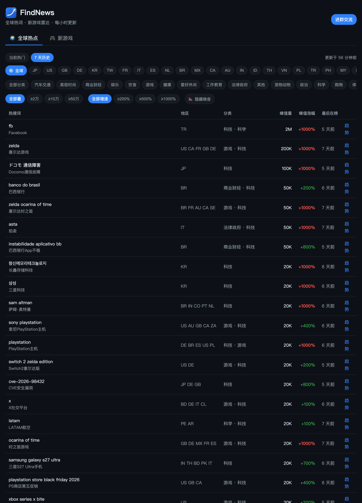
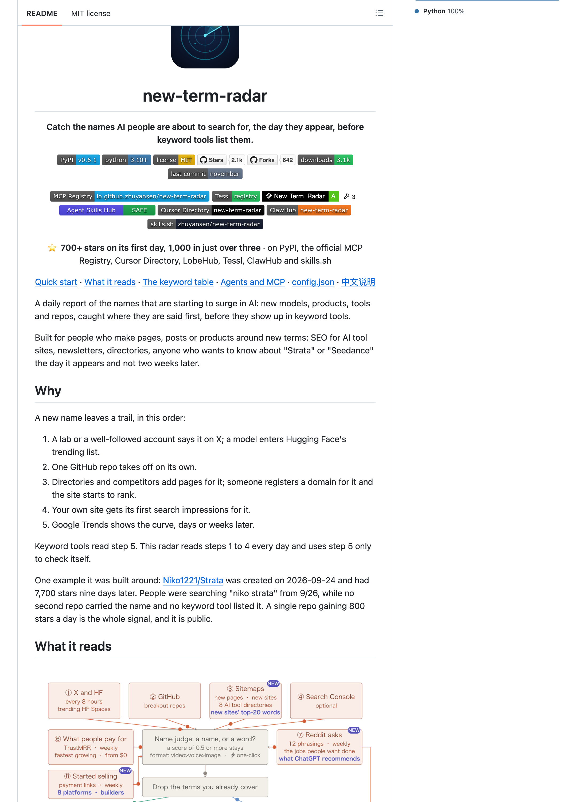
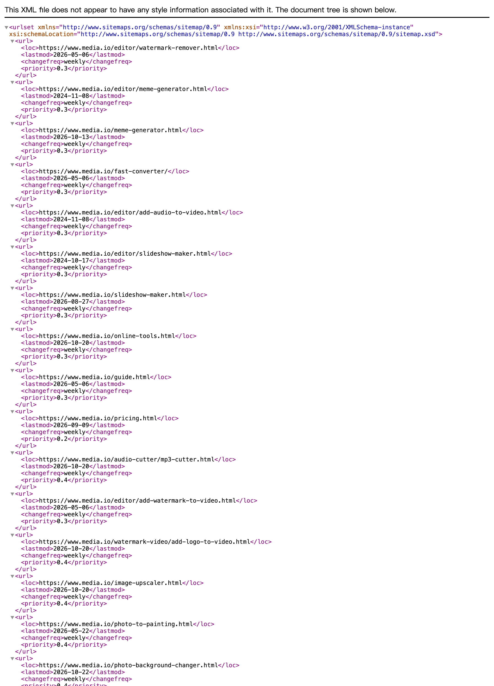
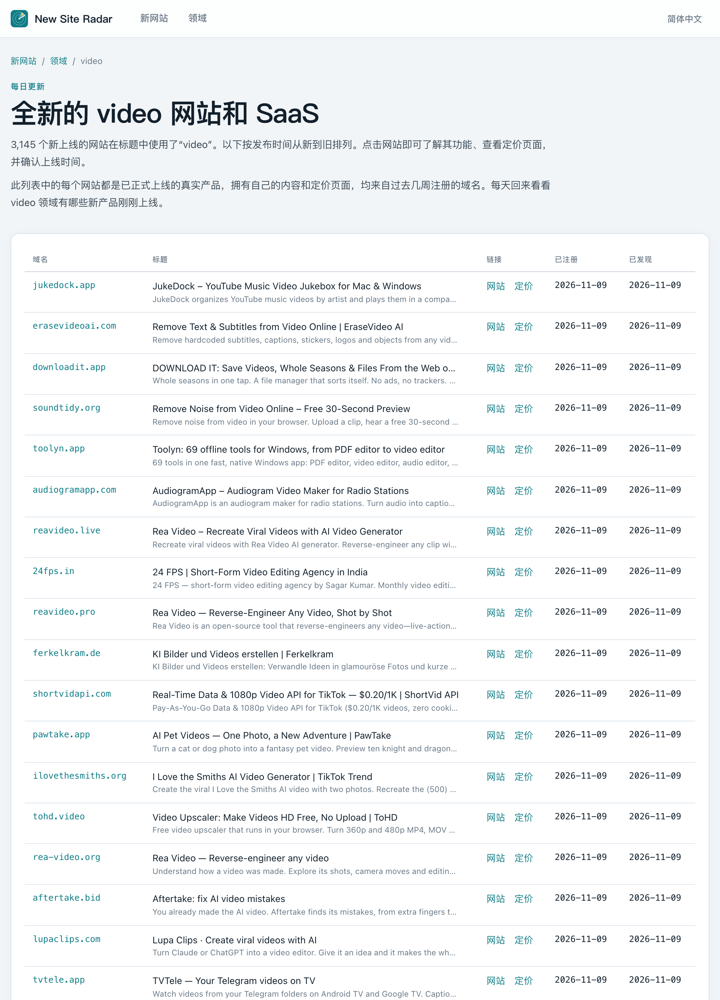
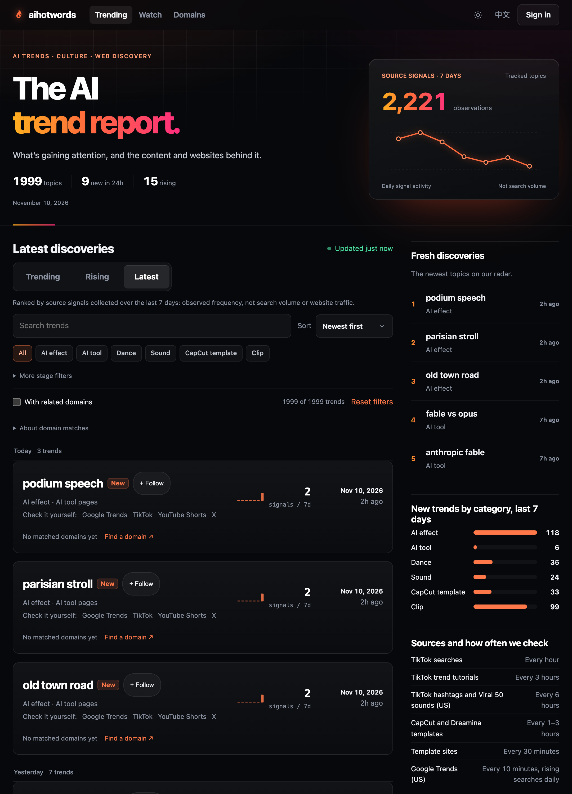
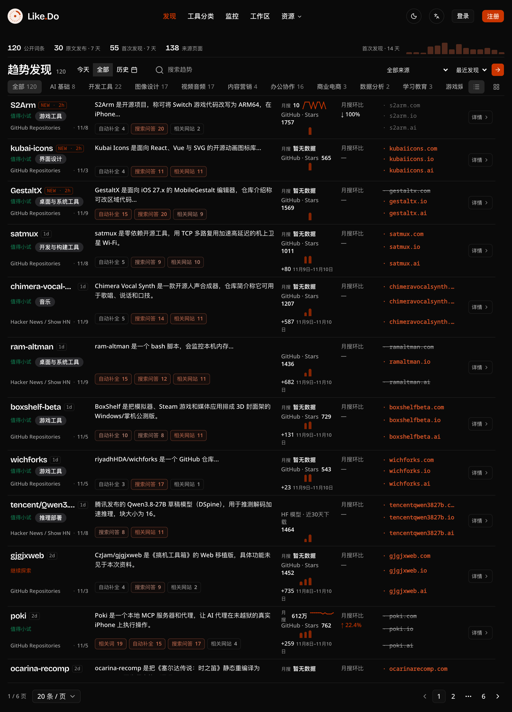
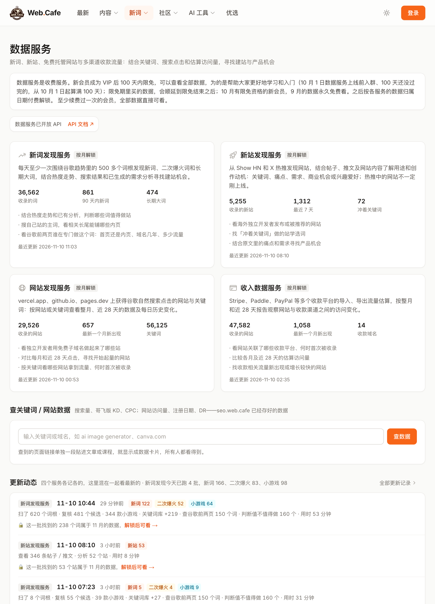

# 新词怎么找？10 个监控工具，网址都在这了

最近跟几个做出海网站的朋友聊天，发现一个共同点：他们这两年的新站，几乎都不是从大词里抢来的，而是靠新词吃到的第一波流量。

大词早就被站群和巨头占住了，一个新域名去拼 "photo editor" 这种词，几个月都上不了首页。但一个刚冒出来的词不一样——搜索量在涨，竞争页面只有个位数，谁先把页面做出来，谁就先吃到。

## 今天就讲讲怎么找新词

新词不是拍脑袋想出来的，是「看」出来的。

它的本质是：某个东西刚出现，用户在搜，但还没有足够多的网站去满足这个搜索。所以找新词这件事，可以拆成三个动作——盯住会先出现新名字的地方、把名字变成关键词、在别人反应过来之前把页面做出来。

下面三条思路，分别对应三种不同的「提前量」。最后附上我仓库里这一类的 10 个工具，逐个说清楚怎么用。

## 思路一：跟着哥飞的数据源看

做出海 SEO 的人基本都知道哥飞（web.cafe）。他的数据服务是目前中文圈里比较成体系的一套新词来源，值得单独说。

**这个数据源是什么**

`https://new.web.cafe/data` 是 Web.Cafe 的数据服务页，一共四个板块：

- **新词发现服务**：每天至少一次，围绕谷歌趋势里的 500 多个词根扫一遍，把新词、二次爆火词、长期大词挑出来。
- **新站发现服务**：从 Show HN 和 X 的推文里发现新站，结合帖子、推文和网站内容，判断用途、痛点、需求、商业机会。
- **网站发现服务**：从 vercel.app、github.io、pages.dev 上抓获得谷歌自然搜索点击的网站与关键词。
- **收入数据服务**：从 Stripe、Paddle、PayPal 等收款平台导入数据，导出流量估算，看网站和收款渠道之间的关系。

我打开时页面上标的数据量是：新词库收录 36,562 个词，其中 90 天内新词 861 个、长期大词 474 个；新站 5,255 个；网站 29,526 个；收入数据 47,582 条。

**能看出什么**

关键不是「有一堆词」，而是每个词后面跟着的东西：热度走势、搜索结果页的竞争情况、以及已经生成好的需求分析。这三样凑在一起，才能回答「这个词值不值得做个站」。

二次爆火词是最容易被忽略的一类。它之前火过一次，页面已经有一批，但这次的热度曲线比上次更陡——说明需求变了，老页面满足不了，新站还有机会。

**怎么用**

1. 先看新词列表，按「90 天内新词」筛，把明显是品牌词、人名、一次性事件的划掉。
2. 剩下的词，回到谷歌趋势里看曲线形状。一条持续向上的斜线比一根尖刺有价值得多。
3. 看搜索结果第一页。如果全是维基、新闻、Reddit 这类非工具页，说明还没有人做产品承接，这就是空位。
4. 再判断做首页还是做内页。词根窄、需求单一时做首页；词根大、能拆出十几个子需求时做内页矩阵。

**免费还是付费**

数据服务是收费的。页面写得很清楚：新会员成为 VIP 后 100 天内免费看全部数据，之后按月解锁；续过费的用户不受限。另外 `https://seo.web.cafe` 那套免费工具箱（趋势查询、关键词拓展、KD 估算、KGR、需求挖掘）不用付费，可以先拿来验证词。

**门槛**

一是要花时间建立判断标准，光看列表看不出价值；二是数据服务有付费节点，100 天免费用完要决定是否续。

## 思路二：跑一个开源的新词监控

如果想自己掌控数据、不想按月付费，可以直接跑开源项目。

**项目名**

`new-term-radar`，仓库地址 `https://github.com/zhuyansen/new-term-radar`。

它的定位写得很直白：在关键词工具把这些名字列出来之前，先在 X、Hugging Face、GitHub、sitemap 上抓到新模型、新产品、新仓库的名字。

**监控逻辑**

它不是去查关键词库，而是盯「名字第一次出现的地方」。一共六个信号源：

1. **X 和 Hugging Face**：每 8 小时扫一次，抓新模型、新产品的发布口径。
2. **GitHub**：抓短时间内 star 暴涨的新仓库。
3. **Sitemaps**：抓新页面、新站，以及站点新增词里的 top 20。
4. **Search Console**（可选）：接自己的站点数据，看哪些查询词开始出现。
5. **付费数据源**：作为最快的增量补充。
6. **启动支付的新站**：刚接上收款的新产品，通常意味着刚上线。

抓到名字之后还有一道判定：名字里包含 video、voice、image 这类严格格式词的比例达到 0.5 以上，才进候选。最后输出一张关键词表，并在 14 天后复查一次——看这个词是真的起来了，还是只是一天的噪音。

这个「14 天复查」是我觉得最值的设计。新词监控最大的坑不是漏掉，是被一堆假信号淹掉。

**怎么跑起来**

它是 Python 项目，Python 3.10 以上，MIT 协议。PyPI 上有包，我截图时是 0.6.1 版本。

```
pip install new-term-radar
```

装完按仓库里的 `docs/quickstart.md` 配好数据源就能跑。除了命令行，它还提供了 Agent Skill 和 MCP server 两种接入方式——如果你平时用 Claude Code、Cursor 这类工具，可以直接让 agent 调它查。

**适合什么规模**

个人和三人以内的小团队最合适。一台机器挂个定时任务就够，数据量不大，跑一轮几分钟。它本身也不是「全量覆盖」的思路，而是「抓到几个就够用」——一个人做站，一天能消化三个新词就已经很好了。

要扩大覆盖范围，需要自己加数据源，这是它留出来的扩展位，不是开箱即用的功能。

## 思路三：盯 AI 站点的 sitemap

第三条思路最笨，但也最直接：找几个更新勤快的 AI 工具站，盯它们的 sitemap。

**怎么做**

打开对方站点的 sitemap.xml，比如 `https://www.media.io/sitemap.xml`。你会看到一堆 `<url>` 块，每一块里四个字段：

- `<loc>`：页面地址
- `<lastmod>`：最后一次修改时间
- `<changefreq>`：更新频率
- `<priority>`：优先级

**监控什么变化**

只看两个东西：

1. **新出现的 `<loc>`**——尤其是 slug 里带功能词的那种，比如 `/watermark-remover`、`/meme-generator`、`/photo-to-painting`。这些路径名就是他们判断出来的新词。
2. **`<lastmod>` 集中在近 30 天的条目**——老页面被重新改，往往意味着这个词的竞争格局变了，他们在补内容。

做法很土：每周拉一次 xml，跟上周的存一份做 diff，只看新增行。

**为什么有效**

AI 工具站上新功能的速度，比关键词工具的更新速度快得多。一个功能上线，第一件事就是建页面、写进 sitemap、提交收录——这是他们的标准动作。

也就是说，sitemap 里的新路径，是「别人已经下过判断的新词」。你不用自己从零判断，只要判断「这个方向我能不能做得更好」。而且这类站通常一次铺几十个页面，等于免费帮你做了一轮需求筛选。

**门槛**

一是要手动维护一个监控名单，找到更新勤快的站点；二是要会一点点 diff，纯手工比对两版 xml 也能做，但费时间。

## 工具清单：10 个，逐个说清楚

下面是我仓库「新词监控」里全部的 10 条，按顺序来。每一个都是我自己打开看过的，网址直接写出来，复制到浏览器就能开。

### 01 Google Trends

**网址**：`https://trends.google.com/trends/`

**给谁用**：所有人。这是新词判断的基准线，其他工具都是围着它转的。

**核心功能**：看一个词的搜索热度随时间怎么变、在哪些地区热、相关查询里冒出了什么。判断「这是不是新词」「这词还能火多久」，最后都要回到这里。

**怎么用**：

1. 在 Explore 里输入关键词，选地区（做哪个市场选哪个）和时间范围（新词一般看过去 30 天或 90 天）。如果只是想看各地区的飙升词，切到 Trending now，按 24 小时看最新一批。
2. 看「随时间变化的趋势」那条曲线。持续上扬是好信号，单根尖刺基本是一次性事件。
3. 往下拉到「相关查询」，切到「飙升」标签。这里出现的词，往往比你自己想的更准。
4. 用「按地区划分的兴趣」确认主战场在哪个国家，别对着美国词做印度市场。

**免费还是付费**：完全免费，不用登录也能查。

**门槛**：需要能正常访问谷歌；有频率限制，短时间连续查很多词会返回 429，得放慢节奏。曲线是相对值不是绝对搜索量，别把峰值当真实搜索量用。


### 02 TrendsBar

**网址**：`https://chromewebstore.google.com/detail/djimlibchepimambphhbhhjegmanioch`

**给谁用**：每天要批量看几十上百个词的 SEO。手工一个个开趋势页太慢，用插件省这一步。

**核心功能**：一个专门给 Google Trends 打辅助的 Chrome 扩展，做两件事——批量打开一组种子关键词的趋势页；在趋势页面里鼠标悬停某个词就能直接对比。

**怎么用**：

1. 在 Chrome 应用商店装好扩展。
2. 点扩展图标，把准备好的种子词一行一个粘进去，它会批量打开对应的趋势页。
3. 在任意 Google Trends 页面上，鼠标悬停关键词，直接出对比曲线，不用再开新标签。

**免费还是付费**：扩展免费安装。我截图时商店页显示 5.0 分（8 个评分）、9,000 用户。

**门槛**：只能装在桌面版 Chrome 上，手机端用不了；本身不提供数据，数据还是谷歌趋势的，所以同样受访问和频率限制影响。



### 03 EasyStarter · 谷歌趋势

**网址**：`https://www.easystarter.dev/zh/trends`

**给谁用**：想直接看「已经筛过一遍的飙升词」，不想从空白搜索框开始的人。

**核心功能**：按产品词根收录谷歌趋势里的相关查询，直接给你一张带涨幅的词表。中文界面。

**怎么用**：

1. 打开页面，先设三个筛选：时间范围、信号、分类。默认是近 30 天、飙升词、全部分类。
2. 看列表。三列：查询词、词根（下面标着分类，比如 notifier/工具、paraphraser/AI 工具）、数值。
3. 挑数值高的词，点进词根看这个词根下还挂着哪些相关词。一个词根挂十几个词，通常意味着能做内页矩阵。
4. 拿筛选出来的词回 Google Trends 复核一遍曲线，再决定要不要做。

**免费还是付费**：免费，不用登录。

**门槛**：词以英文和海外产品为主，中文需求覆盖不到；数值是涨幅百分比，几千几万的涨幅看着夸张，但基数可能很小，必须回趋势里看绝对热度。



### 04 FindNews

**网址**：`https://findnews.me/`

**给谁用**：做热点型站点、小游戏站、工具站，需要按地区找当天冒头的词。

**核心功能**：全球热词和新游戏雷达，每小时更新一次，把各地区的热词、峰值量、涨幅、在榜天数放在一张表里。

**怎么用**：

1. 先切「7 天历史」，默认的「当前热门」经常筛不出结果。
2. 选地区。支持全球和二十多个单一市场（JP、US、GB、DE、KR、BR、MX、IN 等）。
3. 选分类。做工具站就选「科技」「商业财经」，做游戏站选「游戏」。
4. 用量级和涨幅再收窄：≥2 万 / ≥10 万 / ≥50 万，涨幅 ≥200% / ≥500% / ≥1000%。
5. 看「最后在榜」这一列。刚上榜一两天的，才是还有窗口期的词。

**免费还是付费**：免费，不用登录，也没有次数限制。

**门槛**：来源是新闻和搜索热点，噪音多，政治、社会新闻类会混进来，得自己按分类过滤；词的寿命短，看到就得当天动手。



### 05 new-term-radar

**网址**：`https://github.com/zhuyansen/new-term-radar`

**给谁用**：想自己掌控数据、愿意折腾一下命令行的独立开发者。

**核心功能**：开源的新词雷达。不查关键词库，而是盯新名字第一次出现的地方——X、Hugging Face、GitHub、sitemap，抓到之后输出关键词表，14 天后自动复查。

**怎么用**：

1. 装 Python 3.10 以上环境，`pip install new-term-radar`。
2. 按仓库里 `docs/quickstart.md` 配数据源，不配也能跑基础信号。
3. 挂个定时任务，让它按自己的节奏扫（X 和 Hugging Face 是每 8 小时一轮）。
4. 每天看输出的关键词表，挑出能做的词，14 天后再看一遍复查结果。

**免费还是付费**：完全免费开源，MIT 协议。我截图时 2.1k stars、642 forks，PyPI 上 0.6.1 版本。

**门槛**：要会一点命令行；部分信号源需要自己申请访问凭证；它不是全量覆盖型工具，想扩覆盖范围要自己加数据源。



### 06 media.io sitemap

**网址**：`https://www.media.io/sitemap.xml`

**给谁用**：想从竞品身上「抄作业」的人。不知道做什么词的时候，看别人上了什么页面。

**核心功能**：这不是工具，是一个可以直接读的站点地图。里面按 `<loc>`、`<lastmod>`、`<changefreq>`、`<priority>` 列着这个站所有页面的地址和最后修改时间。

**怎么用**：

1. 浏览器直接打开这个 xml，页面会把结构展开成树。
2. 按 `lastmod` 找最近一个月的条目，这些是他们刚上或刚改的页面。
3. 看路径里的 slug，比如 `/watermark-remover`、`/meme-generator`、`/photo-to-painting`——每个路径就是一个他们判断过的新词。
4. 把感兴趣的 slug 拿去谷歌搜一下，看竞争页有多少，再决定自己要不要做。

**免费还是付费**：免费，公开可读。

**门槛**：这个地址是示例，真正的做法是找一批更新勤快的 AI 工具站，各建一条监控；纯手工比对两版 xml 费时间，最好写个小脚本做 diff。



### 07 New Site Radar

**网址**：`https://newsiteradar.aibit.im/zh/niche/video`

**给谁用**：想看「别人正在做什么站」，从新上线产品里反推需求的人。

**核心功能**：按最新发布顺序浏览新上线的网站、SaaS 和初创公司，可以按领域切（video、AI、设计等）。我截图时 video 领域是 3,145 个站。

**怎么用**：

1. 打开后先选领域，比如 video。
2. 列表按上线时间倒序，字段是：域名、标题加简介、「网站」和「定价」两个链接、已注册时间、已发现时间。
3. 先点「定价」，看这个产品怎么收费——有定价页说明已经跑通了商业模式。
4. 再回来看域名和标题，把同一需求下的几个站放在一起比，看谁切的角度更细。
5. 觉得某个方向自己能做，就去查这个词在谷歌的竞争情况。

**免费还是付费**：免费，不用登录。

**门槛**：以英文站为主；列表只是「新」，不代表「有人搜」，还得自己回关键词工具验证需求。



### 08 AI Hot Words

**网址**：`https://aihotwords.com/?sort=latest`

**给谁用**：做短视频、模板、AI 特效类内容站的人。这一类的词起来得最快，也消失得最快。

**核心功能**：AI 相关的趋势词发现。把 TikTok、短视频模板站、谷歌趋势的信号汇总起来，标出哪些话题刚开始冒头。

**怎么用**：

1. 打开默认是 Trending，可以切 Rising 和 Latest。找新词先看 Latest。
2. 用分类标签收窄：All、AI effect、AI tool、Dance、Sound、CapCut template、Clip。
3. 看每条右边的信号数（signals / 7d）。信号来自多个来源的才算真信号，只有一个来源的多半是噪音。
4. 每条下面有「Check it yourself」，直接跳到 Google Trends、TikTok、YouTube Shorts、X 去复核。
5. 还可以点「Find a domain」，看这个词对应的域名有没有被注册。

**免费还是付费**：免费浏览，不用登录，登录是可选的。

**门槛**：偏短视频和模板类话题，做 B 端或工具站的人用不上；页面是英文的；数据以美国市场为主。



### 09 Like.Do

**网址**：`https://like.do/`

**给谁用**：想从 GitHub、Hacker News 这些技术社区里找早期信号的人。

**核心功能**：趋势发现加关键词监控，把新词条、来源页面、相关域名放在一起。我截图时公开词条 120 个，7 天内 30 条有新发文、55 条被激发、138 个来源页面。

**怎么用**：

1. 打开就是「趋势发现」，可以按分类切：AI 基础、开发工具、图像设计、视频音频、内容营销、办公协作、商业电商等。
2. 看每个词条后面的年龄标记（2h、1d、13d）。越新的越有窗口期。
3. 看标签：新产品、开源、声量。标「开源」的词往往对应一个刚发布的 GitHub 项目，可以直接做测评站或教程站。
4. 看下方的来源计数：GitHub Repositories 多少次、Hacker News / Show HN 多少次。被两个来源同时提到的，可信度更高。
5. 看月环比和相关网站——它会把 `.com`、`.io`、`.ai` 三个后缀对应的域名列出来，一眼看出这个词有没有人已经在占位。

**免费还是付费**：公开词条免费浏览，注册后可看更多。

**门槛**：信号偏英文技术圈，中文和非英语市场的词基本没有；词条偏「产品名」而不是「搜索词」，需要自己翻译成用户会搜的说法。



### 10 Web.Cafe 数据服务

**网址**：`https://new.web.cafe/data`

**给谁用**：认真做出海站、愿意为数据付费的人。这是这 10 个里唯一一个收费的，也是信息密度最高的。

**核心功能**：四个板块——新词发现、新站发现、网站发现、收入数据。前面思路一已经详细讲过逻辑，这里说操作。

**怎么用**：

1. 先看「新词发现服务」。三个数字是入口：收录词数、90 天内新词、长期大词。做新站就看 90 天内新词。
2. 点进具体词，看它给的热度走势和搜索结果分析，判断首页还是内页。
3. 切到「新站发现服务」，看最近 7 天新增的站。这是「别人刚下场」的信号，能看出哪些方向正在被验证。
4. 再切「网站发现服务」，按关键词看哪些站拿到了自然搜索点击，找同类里跑得动的。
5. 想验证商业模式就看「收入数据服务」，看哪些站在收款、流量和收款之间的关系。

**免费还是付费**：收费。新会员成为 VIP 后 100 天内免费看全部数据，之后按月解锁；续过费的用户不受限。数据服务已开放 API。

**门槛**：有付费节点，100 天免费用完要决定续不续；数据密度高，没有判断标准的话容易看花眼，建议先想清楚自己要做什么类型的站再看。



## 最后

新词这件事，本质是「比别人早两周知道」。工具能帮你解决的只是「知道」，剩下「做不做、怎么做」还是得自己判断。

上面 10 个工具，不用全用。选一个主数据源（Google Trends 是绕不过去的基准），再配一个能给你提前量的（开源雷达或 sitemap 监控），就够了。剩下的当交叉验证。

祝大家早日月入万刀。

---

数据截至 2026-11-10：本文收录「新词监控」分类 10 条，均逐一打开核实过。

仓库地址（公众号「阅读原文」）：https://linkpad.site/repo/4d19583b-37bb-4232-af2f-edd90c855f98

#新词监控 #出海 #SEO #独立开发 #谷歌趋势
